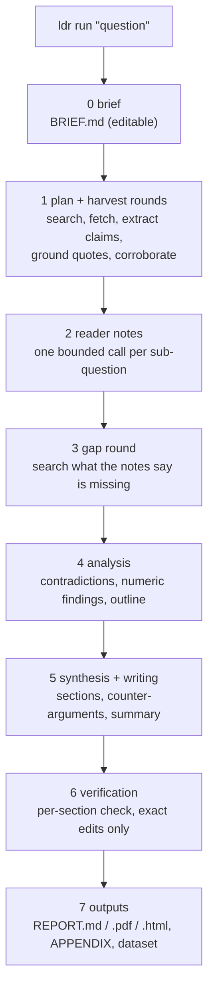

# local-deep-research

Deep research on your own hardware. You ask a question on any topic. `ldr` searches the web and scholarly sources,
reads hundreds or thousands of pages, and checks every claim against the text of its source. It then writes a long,
cited report with a confidence level for each finding.

- **Your model.** Any OpenAI-compatible server: vLLM, llama.cpp, Ollama, LM Studio, SGLang, TGI and others.
  No cloud LLM account is needed.
- **Any topic.** Medicine, history, law, software, finance, art... Nothing in the prompts or rules assumes a field.
  You describe the scope in a short `BRIEF.md`.
- **Verified and cited.** A claim counts only if its quote is found in the fetched page. A finding is rated High only
  when at least two independent sources support it, one of them a primary source such as a paper or official
  documentation. Syndicated copies and content farms do not count as independent sources. The URLs and numbers in
  the report are checked against the evidence.
- **Built for small local models.** The pipeline is ordinary code. It makes many small, single-purpose LLM calls
  (one input, one output, no tools), so a ~30B model with a 32k context can finish a long run.
- **Resumable.** Every phase writes its result to files. After a crash or Ctrl-C, run the same command again.

> **Privacy, precisely:** the LLM, the page cache and all outputs stay on your machine. Search queries do leave it:
> they go to the search engines behind your SearXNG instance and to public scholarly APIs (arXiv, Semantic Scholar,
> Crossref, Europe PMC, ...), and pages are fetched from their sites.

## Contents

- [How it works](#how-it-works)
- [Requirements](#requirements)
- [Quickstart](#quickstart)
- [LLM server recipes](#llm-server-recipes)
- [SearXNG](#searxng)
- [Configuration](#configuration)
- [Profiles](#profiles)
- [Output files](#output-files)
- [Resuming](#resuming)
- [Troubleshooting](#troubleshooting)
- [Limitations](#limitations)
- [Development](#development) · [License](#license)

Türkçe: [docs/README.tr.md](docs/README.tr.md)

## How it works



1. **Brief.** `ldr` turns your question into `BRIEF.md`: the question, its scope and optional local files to take
   into account. You can edit it before the run.
2. **Plan and harvest.** The model splits the question into sub-questions and search queries, including native
   queries in other languages. Each round then works through these steps:
   - search SearXNG and the scholarly APIs;
   - rerank the results and fetch the pages;
   - extract claims with a verbatim quote from each page;
   - keep only claims whose quote is actually in the page text;
   - cluster near-duplicate claims and look for corroborating or contradicting passages in other sources.

   Rounds continue until the profile's size is reached or new rounds stop adding verified evidence.
3. **Reader notes.** One bounded call per sub-question summarises its evidence and lists the gaps.
4. **Gap round.** One more harvest round targets those gaps.
5. **Analysis.** Code collects contradictions and numeric findings and builds an outline of every claim cluster.
   Each cluster is placed in exactly one sub-topic.
6. **Writing.** The model writes each section from that section's evidence lines only. It also writes the
   counter-arguments, an executive summary and a contradictions section.
7. **Verification.** Code flags unsourced tags, numbers found in no evidence and uncited paragraphs. The model then
   checks each section against its evidence and may only propose exact-text edits, which code validates.
8. **Outputs.** The report, an appendix with every verified claim, an audit (`CHECK.md`) and a dataset of everything
   read.

### Safety model

Web pages are written by strangers, and some contain text aimed at LLMs ("ignore previous instructions...").
`ldr` treats every fetched page as untrusted data:

- **No tools for the model.** In the core pipeline the model can only return text or JSON. It cannot run commands,
  read files or fetch URLs. Code decides what happens next.
- **Validated answers.** JSON answers are schema-checked and size-capped. Edits must quote existing text exactly
  and uniquely. A URL or number that the model adds must already appear in the evidence, otherwise the edit is
  rejected or the URL is removed.
- **Prompt hygiene.** Page text is cleaned of chat-template tokens, role prefixes and invisible characters. It is
  wrapped in random per-request markers and passed as data, with the instructions kept apart in the system message.
  Pages that look like prompt injection are flagged and cannot raise a claim's confidence.
- **Fetch guards (SSRF).** Only public addresses are fetched: no localhost, private ranges, link-local or metadata
  IPs, including after redirects and DNS rebinding. The checked IP is pinned for the connection. Response size and
  redirects are capped, and PDFs are parsed in a separate process with limited resources.
- **Files.** Paths built from model or page text must resolve inside the topic folder. Symlinks that lead out of it
  are refused.

See [SECURITY.md](SECURITY.md) for the threat model and how to report a problem.

## Requirements

- **Python 3.10+** on Linux, macOS or Windows.
- **An OpenAI-compatible LLM server** with a context of at least 32k tokens. More context lets each call see more
  evidence, and bigger, stronger models write better reports. The pipeline was developed with a ~27B model at
  32-64k context. Smaller models will run but expect weaker analysis and more rejected edits.
- **SearXNG** with the JSON format enabled. A ready Docker setup is in [docker/searxng](docker/searxng).
- **Disk:** the page cache grows with use, roughly from hundreds of MB to a few GB for large runs.
- Local embedding and reranking models (MiniLM-class, about 0.5 GB in all) are downloaded from Hugging Face on first
  use. They run on the CPU, or on a CUDA GPU when one has free memory.
- **Optional:** PDF reports need WeasyPrint and its system libraries (Pango). Without them the report is also written
  as HTML.

## Quickstart

```bash
git clone https://github.com/<owner>/local-deep-research.git
cd local-deep-research

# pick one:
pip install -e ".[reports]"                        # into the current (virtual) environment
pipx install ".[reports]"                          # isolated, puts `ldr` on your PATH
uv venv && uv pip install -e ".[reports]"          # with uv (then activate .venv)

# start an LLM server (see the recipes below) and SearXNG:
cd docker/searxng && docker compose up -d && cd ../..

ldr doctor                                          # checks the server, SearXNG, models and folders
ldr run "How did the printing press change literacy in early modern Europe?"
```

The `reports` extra adds PDF, XLSX, PPTX and chart output. Leave it out (`pip install -e .`) for a smaller install;
the report is then Markdown (and HTML when possible).

Point `ldr` at your server with a config file or environment variables:

```bash
export LDR_LLM_BASE_URL=http://localhost:11434/v1    # Windows PowerShell: $env:LDR_LLM_BASE_URL="..."
export LDR_LLM_MODEL=qwen3:32b                        # optional: default = the first model the server lists
```

Other commands:

| command | what it does |
|---|---|
| `ldr new "question"` | create the topic folder and `BRIEF.md` only, so you can edit the scope first |
| `ldr run <topic or "question">` | run or resume the whole pipeline |
| `ldr run <topic> --profile derin` | a bigger run (see [Profiles](#profiles)) |
| `ldr run <topic> --until PHASE` | stop after a phase |
| `ldr status <topic>` | phases done, the next one, the last log lines |
| `ldr doctor` | check the setup and print how to fix each problem |

`ldr <command> --help` lists every option.

## LLM server recipes

Any server that implements `POST /v1/chat/completions` and `GET /v1/models` works. Set `llm_base_url` to the URL up
to and including `/v1`.

| server | example start command | base URL |
|---|---|---|
| [vLLM](https://docs.vllm.ai/) | `vllm serve <model> --max-model-len 32768` | `http://localhost:8000/v1` |
| [llama.cpp](https://github.com/ggml-org/llama.cpp) server | `llama-server -m model.gguf -c 32768 --parallel 4` | `http://localhost:8080/v1` |
| [Ollama](https://ollama.com/) | `ollama serve` (set the context, see below) | `http://localhost:11434/v1` |
| [LM Studio](https://lmstudio.ai/) | Developer tab, start the server | `http://localhost:1234/v1` |

Notes:

- **Context.** Set `llm_context` to the context the server really uses, not the model's maximum. Ollama's default
  context is small. Raise it, for example with `OLLAMA_CONTEXT_LENGTH=32768 ollama serve` or a Modelfile with
  `PARAMETER num_ctx 32768`. Otherwise long prompts are cut silently.
- **Parallel requests.** `ldr` sends up to `llm_concurrency` requests at once (default 16). vLLM and SGLang batch
  them efficiently. For llama.cpp, match its `--parallel` slots. For Ollama, match `OLLAMA_NUM_PARALLEL`. The context
  is split between llama.cpp's slots, so `-c` must be `slots x llm_context`.
- **Thinking models** (Qwen3 and similar): set `no_think = true` under `[llm]`. With thinking on, a JSON call can
  spend its whole budget on reasoning and return nothing; a live Qwen3 run used 16,000 tokens of reasoning on the
  plan and stopped. `<think>` blocks are stripped from answers either way.
- **A second, faster model** can do the bulk claim extraction: set `[extract] base_url` / `model`.
- **API keys:** set `llm_api_key` (or `OPENAI_API_KEY`) if your server requires one.

## SearXNG

`ldr` needs a SearXNG instance that answers `GET /search?q=...&format=json`. The setup in
[docker/searxng](docker/searxng) binds it to `127.0.0.1:8888`, enables JSON and turns the rate limiter off for this
single local client:

```bash
cd docker/searxng
# put a random string into settings.yml -> server.secret_key first
docker compose up -d
curl "http://localhost:8888/search?q=test&format=json"   # must print JSON
```

If you already run SearXNG, add `json` to `search.formats` in its `settings.yml` and set `searxng_url`.

## Configuration

Settings are resolved in this order (later wins):

1. built-in defaults;
2. a TOML file: `$LDR_CONFIG`, else `./ldr.toml`, else the user config file:
   - Linux: `~/.config/local-deep-research/config.toml`;
   - macOS: `~/Library/Application Support/local-deep-research/config.toml`;
   - Windows: `%APPDATA%\local-deep-research\config.toml`;
3. environment variables `LDR_<KEY>`, for example `LDR_LLM_BASE_URL`. `OPENAI_BASE_URL` and `OPENAI_API_KEY` are used
   when the `LDR_` variants are not set.

In the TOML file, `[llm] base_url = "..."` and `llm_base_url = "..."` mean the same key. A commented example of every
key is in [config.example.toml](config.example.toml).

| key | default | meaning |
|---|---|---|
| `llm_base_url` | `http://localhost:8000/v1` | OpenAI-compatible server, up to and including `/v1` |
| `llm_model` | `""` | model id; empty = the first model the server lists at `/v1/models` |
| `llm_api_key` | `""` | sent as `Authorization: Bearer`; empty = no header |
| `llm_context` | `32768` | the server's context window in tokens; prompts are sized below it |
| `llm_concurrency` | `16` | parallel requests |
| `extract_base_url` | `""` | optional second server for bulk claim extraction; empty = `llm_base_url` |
| `extract_model` | `""` | its model; empty = the first one it lists, or `llm_model` when no second server is set |
| `extract_api_key` | `""` | its key; empty = `llm_api_key` |
| `searxng_url` | `http://localhost:8888` | SearXNG base URL (`/search` is appended) |
| `academic_share` | `0.4` | share of each round's pages reserved for scholarly sources (journals, DOI / arXiv, scholarly encyclopedias, university repositories) when enough relevant ones exist; `0` = off |
| `embed_model` | `sentence-transformers/all-MiniLM-L6-v2` | CPU embedding model |
| `embed_model_gpu` | `BAAI/bge-m3` | used only when a CUDA GPU has room; `""` = never |
| `multilingual_embed_model` | `sentence-transformers/paraphrase-multilingual-MiniLM-L12-v2` | for non-English results |
| `cross_encoder` | `cross-encoder/ms-marco-MiniLM-L6-v2` | reranker for search results |
| `multilingual_cross_encoder` | `cross-encoder/mmarco-mMiniLMv2-L12-H384-v1` | reranker for non-English results |
| `cache_dir` | `""` | page cache shared by all topics; empty = the user cache dir |
| `research_root` | `""` | where new topics are created; empty = `./research-projects` |

## Profiles

A profile sets the size of the harvest: rounds, sub-questions, pages per round and how many corroboration pairs are
judged. Use `--profile` with the Turkish name or its English alias.

| profile | alias | rounds | sub-questions | expected sources | what it is for |
|---|---|---|---|---|---|
| `normal` | `fast` | 3 | 8 | ~440 | a solid report on a focused question (the default) |
| `derin` | `deep` | 4 | 14 | ~1,500 | a broad question with many sides |
| `maksimum` | `max` | 6 | 20 | ~5,800 | exhaustive coverage; a day or more of compute |
| `dinamik` | `dynamic` | until saturation (at most 5, 36 h) | 12 | open-ended | keeps going while rounds still add verified evidence |

- `--sources N` scales any profile to about N sources. Without a profile, N picks one.
- `--max-rounds N` caps the rounds.
- `--langs de,zh,ja` (or `all` / `none`) chooses the extra search languages. English is always searched.
- `--out-lang` sets the report language. It is taken from `BRIEF.md` when given, else English.

Every profile stops early when a round adds too little new verified evidence. Run time depends almost entirely on
your server's throughput. As a rough guide from development runs on one GPU with a ~27B model, `normal` takes a few
hours and `derin` most of a day. Your numbers will differ.

## Output files

Everything is written under `<research_root>/<topic>/research/`:

| file | contents |
|---|---|
| `REPORT.md` | the report: executive summary, one part per sub-question, counter-arguments, contradictions, sources |
| `REPORT.pdf` / `REPORT.html` | rendered report (PDF with WeasyPrint, else HTML) |
| `REPORT.xlsx`, `REPORT.pptx` | tables and a slide summary (with the `reports` extra) |
| `APPENDIX.md` (+ `.pdf`) | every verified claim cluster with its confidence, sources and whether the report cites it |
| `CHECK.md` | audit of the report against the claim database: overclaimed or unsourced confidence tags, heading and figure problems |
| `VERIFY-NN.md` | per sub-question: each checked claim's verdict and every applied or rejected edit |
| `claims/claims.csv`, `claims/CLAIMS.md` | the claim database: clusters, confidence, sources, quotes |
| `claims/CONTRADICTIONS.md` | claims that sources disagree on |
| `data/numeric-findings.csv` | numbers found in the evidence (metric, value, source) for charts |
| `notes/`, `analysis/`, `report/` | intermediate files: reader notes, outlines, section files |
| `harvest/` | plan, per-round metrics (`ROUNDS.md`), profile |
| `interim/` | an interim report after every harvest round |
| `dataset/`, `dataset.zip` | every page read, every claim and query, as plain text and JSONL, with a dataset card |
| `TELEMETRY.md` | timing and throughput of the run |

Confidence levels:
- **High:** at least two independent sources, at least one of them primary (scholarly, official documentation, .gov
  or .edu ...), with a quote found verbatim in a source.
- **Medium:** a grounded quote, without that support.
- **Low:** the quote could not be found in its source.

## Resuming

Each phase skips itself when its output already exists. Inside the harvest, rounds and their stages (search, fetch,
extract, verify) are checkpointed. To resume after a crash, a reboot or Ctrl-C, run the same command again:

```bash
ldr run <topic>
ldr status <topic>       # see what is done and what comes next
```

To redo a phase, delete its output file and run again. Fetched pages stay in the shared cache, so a rerun does not
download them again.

## Troubleshooting

**`LLM server unreachable`** — `ldr doctor` prints the URL it tried.
- Check the server is running and that `llm_base_url` ends in `/v1`.
- From WSL2 or a container, `localhost` may not be the host. Use the host's IP or `host.docker.internal`.

**`401` / `403` from the LLM server** — set `llm_api_key` (or `OPENAI_API_KEY`).

**SearXNG returns 403 or HTML** — the JSON format is off. Add `json` under `search.formats` in its `settings.yml`.

**SearXNG returns few or no results** — public engines throttle heavy use, which is often visible in the SearXNG
logs. Enable more engines in `settings.yml`, or use a smaller profile.

**Context errors / truncated answers** — `llm_context` is larger than what the server actually runs. Set it to the
server's real context. With Ollama, raise `num_ctx`; with llama.cpp, raise `-c` (divided across `--parallel` slots).

**Timeouts with llama.cpp / Ollama / LM Studio** — lower `llm_concurrency` to the server's parallel slots.

**No PDF** — WeasyPrint or Pango is missing, so the report is written as `REPORT.html`. Print it to PDF from a
browser, or install Pango:
- Debian/Ubuntu: `apt install libpango-1.0-0 libpangoft2-1.0-0`;
- macOS: `brew install pango`;
- Windows: see WeasyPrint's installation docs (MSYS2 / GTK runtime).

**Windows notes**
- Use a recent Python from python.org or the Microsoft Store.
- Run `ldr` from PowerShell or Windows Terminal; all files are read and written as UTF-8.
- Docker Desktop runs the SearXNG setup unchanged.

**Hugging Face downloads blocked** — download the models from the [configuration table](#configuration) once on a
connected machine, copy `~/.cache/huggingface`, and set `HF_HUB_OFFLINE=1`.

## Limitations

- **Quality follows the model.** A small model misses nuance, writes flatter prose and has more edits rejected.
  The verification steps catch unsupported URLs and numbers, but they cannot make a weak analysis strong.
- **Verified means quoted, not true.** A High claim is one that two independent pages state. The pages can still be
  wrong, outdated or biased. Read the sources for anything that matters.
- **Paywalls and scripts.** Pages that need a login or render only with JavaScript yield no text. Abstracts and open
  versions are used where available.
- **Search coverage** depends on your SearXNG engines and on public API rate limits. Large runs may be throttled.
- **Long runs.** Big profiles take many hours of GPU time.
- **Not a substitute for expert review** in medical, legal, financial or safety-critical decisions.
- No benchmark against commercial deep-research products has been run. No such comparison is claimed.

## Development

```bash
pip install -e ".[dev,reports]"
python -m pytest -q tests          # offline: no LLM, no network
```

See [CONTRIBUTING.md](CONTRIBUTING.md) for the test layout and conventions.

## License

MIT, see [LICENSE](LICENSE).
